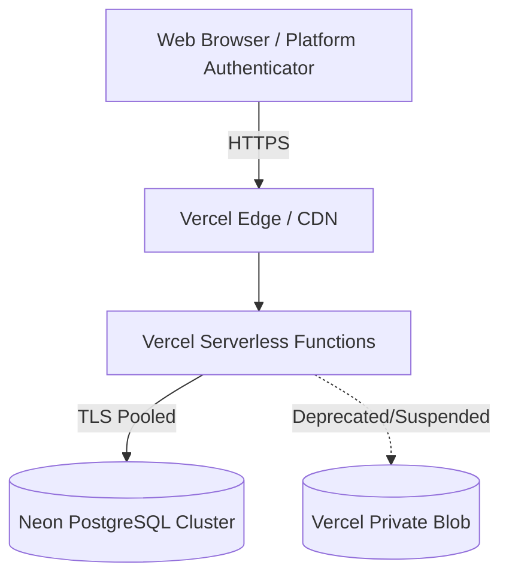

# Attack Surface Inventory
## Secret Santa 56 Participants Application

- **Date:** November 11, 2026
- **Assessed By:** M5 Autonomous Red Team
- **Target Deployment:** Next.js 16 (App Router) on Vercel Serverless + Neon Serverless PostgreSQL

---

### 1. External Network & Application Surfaces

The application exposes 1 public frontend view, 1 administrative dashboard view, and 30 RESTful API endpoints.

### 2. Complete API Endpoint Inventory

| Endpoint Route | HTTP Method | Auth Required | Purpose / Risk Profile | Enforced Protection |
|---|---|---|---|---|
| `/` | `GET` | None | Participant selection grid and reveal UI | Read-only static page |
| `/admin` | `GET` | Admin Session | Organizer administrative control panel | Touch ID / Master password gate |
| `/api/participants` | `GET` | None | Directory of 56 participants (names, reveal flags) | Strips codes, recipients, and PIN hashes |
| `/api/auth/pin` | `POST` | None (Enrolls/Auths) | 4-digit PIN authentication and initial registration | Rate limited (5 req/15m), Device lock |
| `/api/auth/session` | `GET` | Participant Cookie | Session verification and device validation | Invalidation if unbound by admin |
| `/api/auth/logout` | `POST` | Participant Cookie | Clears participant session and device cookies | `Max-Age: 0` Set-Cookie headers |
| `/api/auth/device-status` | `GET` | None (Device Headers) | Checks if current device/hardware is bound | Queries PostgreSQL device_bindings |
| `/api/auth/biometric/options` | `POST` | None | Generates WebAuthn options (Register or Auth) | RP ID whitelist, Device conflict check |
| `/api/auth/biometric/verify` | `POST` | None | Verifies WebAuthn assertion / attestation | Cryptographic signature & anti-replay |
| `/api/reveal` | `POST` | Participant / PIN | Reveals secret gift recipient | Device binding, rate limits, salt decrypt |
| `/api/santa/chat` | `POST` | None | Interactive festive Santa chatbot | Gemini 3.8/3.5 Flash, 30 req/min rate limit |
| `/api/admin/auth` | `POST` | None | Verifies master admin password | Scrypt hash comparison, issues HMAC token |
| `/api/admin/status` | `GET` | Admin Session | Complete event status and audit ledger | Redacts recipient pairings & PIN hashes |
| `/api/admin/generate` | `POST` | Admin Session | Full draw regeneration & security wipe | Concurrency lock, backup creation |
| `/api/admin/reset` | `POST` | Admin Session | Full event reset to ungenerated status | Atomic PostgreSQL wipe & backup |
| `/api/admin/reset-devices` | `POST` | Admin Session | Standalone device unbinding | Permanently disabled (HTTP 403) |
| `/api/admin/reset-participant`| `POST` | Admin Session | Single participant recovery & credential wipe | Clears Postgres credentials & bindings |
| `/api/admin/change-password` | `POST` | Admin Session | Master password update | HMAC cookie update, min 6-char length |
| `/api/admin/draw-mode` | `POST` | Admin Session | Switches between Free and Constrained mode | Re-validates derangement constraints |
| `/api/admin/clear-audit` | `POST` | Admin Session | Wipes administrative audit ledger | Requires active admin authentication |
| `/api/admin/passkey/*` | Multiple | Admin Session | Manages admin Touch ID / WebAuthn credentials | Exclude credentials, counter tracking |

### 3. Data Storage & Persistence Surface

1. **`event_meta` Table:**
   - Holds `master_event_state` (Round number, encrypted recipients, draw mode, master salt).
   - Backup snapshots stored during draw regenerations (`backup-pre-full-regenerate-*`).
2. **`event_participants` Table:**
   - Holds 56 individual participant records (`id`, `name`, `pin_hash`, `pin_salt`, `passkey_credential_id`, `passkey_counter`, `is_revealed`).
3. **`device_bindings` Table:**
   - Maps physical browser `device_id` to `participant_id`.
   - `PRIMARY KEY (device_id)`, `UNIQUE (participant_id)`.
4. **`hardware_bindings` Table:**
   - Maps physical display, GPU WebGL capability, and silicon metrics to `participant_id`.
   - `PRIMARY KEY (hardware_fingerprint)`, `UNIQUE (participant_id)`.
5. **`distributed_rate_limits` Table:**
   - Tracks atomic request attempts and lockouts across serverless lambda containers.
